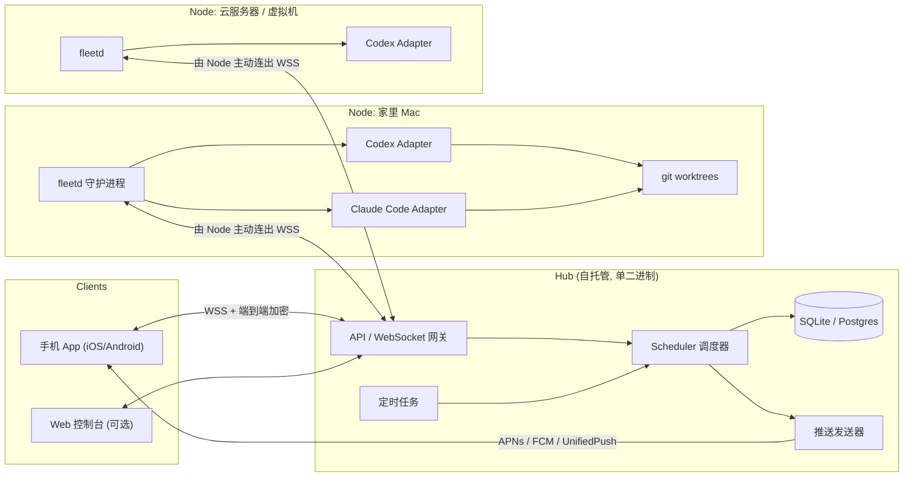
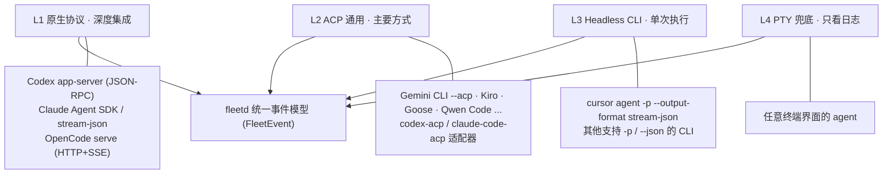
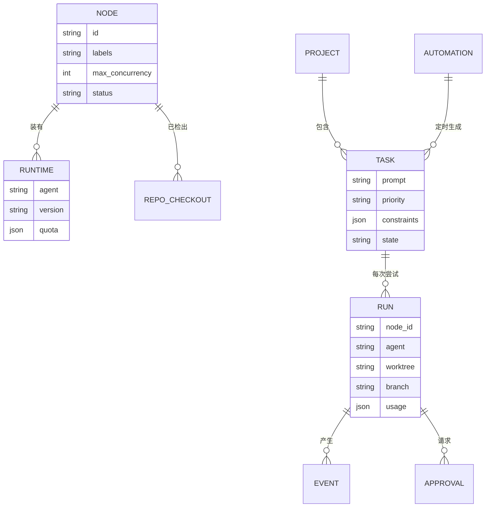
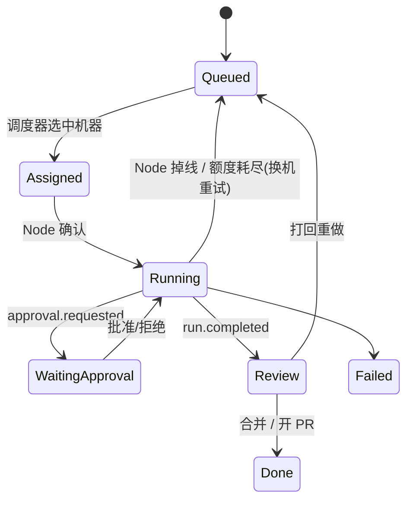
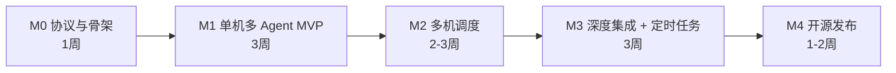

# AgentFleet（暂定名）设计文档

> 开源、可自托管的**手机端 Coding Agent 资源调度平台**。参考 Codex 桌面端「多 agent 指挥中心」的交互，把能力扩展到**多台机器 × 多种 agent**，手机负责下发、监控、审批。

---

## 1. 定位

| | 官方 ChatGPT 手机端 / Claude Remote Control | Remodex / Happy 等第三方 | **AgentFleet** |
|---|---|---|---|
| 控制对象 | 1 台电脑上的自家 agent | 1 台电脑，1–2 种 agent | **N 台机器 × M 种 agent** |
| 任务队列 / 调度 | 无 | 无 | **有（排队、按标签分配、额度管理、失败转移）** |
| 定时任务 | 官方有，但只跑自家 agent | 无 | 有，跨机器 |
| 自托管 | 否 | 部分支持 | **完全支持，不依赖任何中心服务** |

**一句话**：不是又一个「手机遥控器」，而是 **coding agent 的个人或小团队调度系统，手机是它的主界面**。

## 2. 开源带来的设计原则

1. **自托管优先**：一个 Hub 二进制文件或 `docker compose up` 就能跑；家里一台 NAS 或树莓派就够用。
2. **用户自带凭证**：Codex、Claude 等账号凭证**只存在 Node 本机**，Hub 和手机都碰不到。
3. **以 Node 端的规则为准**：Node 本地的审批规则拥有最终决定权，Hub 被攻破也无法越权执行命令。
4. **协议先行**：Hub↔Node、App↔Hub 的协议用 JSON Schema 定义并版本化。社区可以只写一个 Adapter 或另做一个客户端（Web、TUI、Telegram Bot）。
5. **Adapter 插件化**：新增一种 agent 只需要实现一个接口，不用改调度核心。

## 3. 总体架构



**组件职责**

| 组件 | 职责 |
|---|---|
| **App** | 任务列表和对话界面、新建任务、实时日志、审批、查看代码改动、合并或开 PR、机器和额度看板 |
| **Hub** | 设备配对、任务队列、调度、消息中转、定时任务、推送、审计日志。**不执行代码，不保存 agent 凭证** |
| **fleetd（Node）** | 主动连接 Hub（无需公网 IP）、上报机器能力和心跳、管理 worktree、拉起 Adapter、在本地执行审批规则 |
| **Adapter** | 把不同 agent 的原生协议统一转换成 AgentFleet 的事件格式 |

## 4. 多 Agent 接入方案（核心）

### 4.1 关键判断：以 ACP 作为通用接入方式，原生协议做深度集成

如果每种 agent 都单独写一个 Adapter，N 种 agent 就要写 N 个，维护成本会把开源项目拖垮。
**[ACP（Agent Client Protocol）](https://agentclientprotocol.com)** 是 Zed 和 JetBrains 主导的开放标准：基于 stdio 的 JSON-RPC，定义了会话、流式更新、工具调用、权限请求等。官方注册表已收录约 50 个 agent（Gemini CLI 原生支持 `--acp`，Kiro、Goose 等也支持；Claude Code、Codex 有社区维护的 ACP 适配器）。

**结论**：AgentFleet **实现一个 ACP Client，就能接入整个 ACP 生态**；只对少数主流 agent 再写原生 Adapter，用来拿到 ACP 没有的能力（额度、恢复或分叉会话、内置代码审查等）。

### 4.2 四级接入方式



| 级别 | 方式 | 能做什么 | 不能做什么 | 实现成本 |
|---|---|---|---|---|
| **L1 原生** | 各家官方协议或 SDK | 全部功能：结构化审批、额度和用量、恢复或分叉会话、代码审查、结构化输出 | — | 每种 agent 各写一份，跟着上游升级 |
| **L2 ACP** | 实现一次 ACP Client | 多轮对话、流式消息、工具调用、执行计划、**权限请求**（`session/request_permission`）、代码改动、按会话下发 MCP 配置 | 额度和用量通常拿不到，会话分叉不统一 | **写一次，覆盖所有 ACP agent** |
| **L3 Headless** | `-p` 加 JSON 流输出 | 单次执行，可以解析出进度和结果 | 中途不能交互审批，只能预先设好允许的操作，并在沙箱里跑 | 低，每种 agent 一个配置文件 |
| **L4 PTY** | 伪终端加按键转发 | 看实时日志，粗略地转发按键 | 没有结构化信息，容易出问题 | 最低 |

**选择规则**：同一个 agent 如果有多种接入方式，按 L1 > L2 > L3 > L4 的顺序自动选，用户也可以手动指定。

### 4.3 能力声明：功能和调度按能力降级

每个 Adapter 在 `probe()` 时声明自己支持哪些能力，App 界面和调度器据此自动降级：

```ts
interface Capability {
  agent: string; version: string; tier: "native" | "acp" | "headless" | "pty";
  loggedIn: boolean; models: string[];
  supports: {
    interactiveApproval: boolean;  // 支持审批交互
    multiTurn: boolean;            // 可以追加指令、纠正方向
    resume: boolean; fork: boolean;
    usageReport: boolean;          // 能上报 token 和额度
    structuredDiff: boolean;
    mcpInjection: boolean;
    images: boolean;
  };
}
```

- 任务**需要人工审批**的，只调度到 `interactiveApproval = true` 的组合上；否则必须在只读或受限写入的沙箱中运行，并使用预先批准的规则。
- `usageReport = false` 的 agent，额度标记为「未知」，调度时降低它的权重，并在本地按时间窗口统计调用次数来估算。
- App 根据能力隐藏不可用的按钮（例如 L3 级别的任务没有「追加指令」）。

### 4.4 统一接口

```ts
interface AgentAdapter {
  id: string;                          // "codex" | "claude-code" | "acp:<name>" | ...
  probe(): Promise<Capability>;
  startRun(spec: RunSpec): RunHandle;  // 在指定 worktree 中启动
}
interface RunSpec {
  cwd: string; prompt: UserInput[]; model?: string;
  policy: ApprovalPolicy;              // 统一审批规则，由 Adapter 翻译成各 agent 的原生设置
  mcpServers?: McpServerConfig[];      // 统一 MCP 配置，由 Adapter 翻译
  instructions?: string;               // 统一的项目说明
}
interface RunHandle {
  events: AsyncIterable<FleetEvent>;
  send(input: UserInput): Promise<void>;
  resolveApproval(id: string, d: Decision): Promise<void>;
  interrupt(): Promise<void>;
}
```

### 4.5 统一事件格式（FleetEvent）：以 ACP 为基础扩展

**设计原则：FleetEvent 包含 ACP 的全部事件类型，并在此基础上扩展。** 这样 ACP Adapter 基本就是直接转发，其他协议再映射过来。

| FleetEvent | ACP `session/update` | Codex app-server | Claude stream-json |
|---|---|---|---|
| `message.delta` | `agent_message_chunk` | `item/agentMessage/delta` | `assistant` text |
| `reasoning.delta` | `agent_thought_chunk` | reasoning item | thinking block |
| `plan.updated` | `plan` | todo / plan item | TodoWrite tool |
| `tool.started / updated` | `tool_call` / `tool_call_update` | `commandExecution` / `fileChange` item | `tool_use` / `tool_result` |
| `approval.requested` | `session/request_permission` | `execCommandApproval` / `applyPatchApproval` | 权限回调 / hook |
| `usage.updated` ➕ | （扩展字段） | token usage 通知 | `result.usage` |
| `run.completed / failed` | `session/prompt` 返回 stopReason | `turn/completed` | `result` |

> ➕ 表示 FleetEvent 自己扩展的事件。实现时以各协议生成的 schema 为准，上表的字段名只用来说明映射关系。

### 4.6 不同 agent 之间的差异和统一方式

| 差异 | 问题 | 统一方式 |
|---|---|---|
| **项目说明文件** | `AGENTS.md` / `CLAUDE.md` / `GEMINI.md` 各不相同 | 以 `AGENTS.md` 为准，fleetd 在 worktree 中按需生成软链接，或通过 `instructions` 字段注入 |
| **MCP 配置** | 每家配置格式不同 | Fleet 层统一配置，ACP 通过 `session/new` 的 `mcpServers` 传入，原生 Adapter 各自翻译 |
| **审批语义** | 每家分级方式不同（命令、补丁、网络等） | 统一成四类风险：**读 / 写工作区 / 执行命令 / 高危**，由 Adapter 双向映射；Node 上的 `policy.yaml` 写一次，对所有 agent 生效 |
| **登录** | OAuth、API key、设备码各不相同 | 凭证只在 Node 上。未登录时 App 显示「需要在 Node 上登录」；支持设备码登录的，把链接和验证码推送到手机，在手机上完成授权 |
| **模型和推理强度** | 参数名不同 | `RunSpec.model` 加上 Adapter 内部的映射表；App 显示各 agent 实际可用的模型列表 |
| **版本更新** | 上游升级后协议会变 | 每个 Adapter 配契约测试，CI 每天用最新版跑一遍，失败时自动降级到 L2 或 L3 |

### 4.7 多 Agent 带来的独有功能

1. **同一任务多 agent 并行比较（best-of-N）**：同一个任务同时交给 Codex、Claude、Gemini，各用一个独立的 worktree，手机上并排比较代码改动和测试结果，选一个合并。
2. **中途切换 agent**：一个 agent 额度用完或卡住时，把当前分支和一份自动生成的进度摘要交给另一个 agent 接着做（交接靠 git 分支和摘要，不迁移上下文）。
3. **按任务类型路由**：例如 UI 任务交给 A，大规模重构交给 B，代码审查交给 C，规则可以配置，以后也可以根据历史成功率自动学习。
4. **交叉审查**：A 写完的代码由 B 用内置的 review 功能审查，审查意见推送到手机。

## 5. 数据模型



**任务状态机**



## 6. 调度器（核心差异化）

### 6.1 任务约束（用户在手机上填，大部分可以不填）

```yaml
repo: github.com/me/app
agent: any               # any / codex / claude-code / acp:gemini / [codex, claude-code]
mode: single             # single | best_of_n | cross_review
requires: [interactiveApproval]   # 需要的能力，见 4.3
labels: [gpu?, macos?]   # 例如需要 Xcode 的任务必须分到 macOS 机器
priority: normal         # low / normal / high
budget: { max_tokens: 2M }
```

### 6.2 两步算法：先过滤，再打分

调度的基本单位是一个 **(Node, Runtime) 组合**，也就是「某台机器上的某个 agent」。

```text
candidates = [(n, r) for n in nodes for r in n.runtimes if
    n.online && n.running < n.max_concurrency
    && n.has_repo_or_can_clone(task.repo)
    && n.labels ⊇ task.labels
    && matches(task.agent, r) && r.loggedIn
    && r.supports ⊇ task.requires
    && r.quota_state != exhausted]

score(n, r) =
    w1 * 剩余额度比例(r)          // 额度未知时取保守值 0.3
  + w2 * (1 - 负载(n))
  + w3 * 仓库亲和(n)            // 已经检出过、有依赖缓存的机器优先
  + w4 * 接入级别分(r.tier)     // native > acp > headless > pty
  + w5 * 历史成功率(r, 任务类型)
  + w6 * 用户偏好(n, r)
  - w7 * 预估成本(r)
```

- **best_of_n**：从不同的 agent 中各取一个得分最高的组合，并行执行。
- **cross_review**：执行完成后，自动创建一个审查任务，并且排除刚才执行的那个 agent。
- **额度跟踪**：Adapter 定期上报 `usage.updated`，Hub 按账号维护滑动窗口。遇到速率限制错误时，把对应账号冷却一段时间。
- **失败转移**：Node 心跳超时，或返回额度耗尽，任务重新入队，并排除刚失败的那组机器和 agent，最多重试 N 次；`agent: any` 的任务可以转给其他 agent，交接方式见 4.7。
- **公平性**：每个项目一个队列，按加权轮询取任务，避免一个定时任务把机器全部占满。
- **不做抢占**：agent 任务中途很难暂停和迁移，第一版只做排队。

## 7. 安全模型

| 层 | 措施 |
|---|---|
| 配对 | Node 和手机通过**扫二维码**交换 X25519 公钥（参考 Noise 协议的 IK 模式），Hub 只负责转发 |
| 传输 | 全程 TLS，**App↔Node 之间再加一层端到端加密**：Hub 看到的只是加密数据和调度所需的元数据（仓库、标签、状态） |
| 执行 | Node 本地 `policy.yaml` 为准：允许和禁止的命令、可写路径、是否允许联网；默认使用 agent 自带的沙箱（Codex 用 `workspaceWrite`） |
| 审批 | 高风险操作（`rm -rf`、`git push --force`、执行网络脚本）**必须在手机上生物识别确认** |
| 审计 | 所有审批和命令写入只追加的审计日志，可导出 |
| 凭证 | agent 凭证只存在 Node 上；Hub 用设备令牌（可吊销），不使用账号密码 |

## 8. 开源项目特有的问题：推送通知

自托管的用户**没法直接用官方 App 的 APNs 证书**。

**方案**（参考 Matrix Sygnal、ntfy 的做法）：

1. 项目方运营一个**免费的推送网关**，只转发「有新事件」这样不含内容的唤醒信号。App 被唤醒后，再直接连用户自己的 Hub 拉取内容。
2. Android 额外支持 **UnifiedPush**（可以完全不依赖 Google 服务，能上 F-Droid）。
3. 想彻底独立的用户，可以自己编译 App 并配置自己的 APNs key。

## 9. 技术选型

| 部分 | 选型 | 理由 |
|---|---|---|
| **fleetd** | **TypeScript（用 Bun 编译成单个二进制）** | 支持多 agent 后，生态以 TS 为主：ACP 官方 TS SDK、Claude Agent SDK、Codex TS SDK、OpenCode SDK 都是 TS；编译后同样是单个可执行文件 |
| Hub | TypeScript（推荐，和 App、fleetd 共享类型）/ Go | 全栈统一语言，社区贡献门槛最低；如果更看重性能和低内存，可以改用 Go |
| 存储 | SQLite（默认）/ Postgres | 个人用零配置，团队用可扩展 |
| App | **React Native + Expo** | 一套代码同时出 iOS 和 Android，和后端共享 `proto` 类型；用 Shiki 渲染代码改动 |
| 协议 | JSON Schema（基于 ACP schema 扩展）→ 自动生成 TS / Go 类型 | 方便第三方客户端接入 |
| 内网穿透 | Node 主动连出；可选 Tailscale | 不需要公网 IP |

> [!NOTE]
> 原方案后端用 Go。改成支持多 agent 之后，**TS 能直接用各家官方 SDK**，省掉大量协议的重复实现，所以推荐改用 TS。

## 10. 仓库结构

```
agentfleet/
├─ proto/                 # FleetEvent / API JSON Schema（基于 ACP 扩展）+ 生成代码
├─ hub/                   # api, scheduler, relay, cron, push
├─ fleetd/                # node daemon, worktree, policy
│  └─ adapters/
│     ├─ acp/             # ★ 通用 ACP Client（覆盖整个 ACP 生态）
│     ├─ codex/           # L1: app-server stdio JSON-RPC
│     ├─ claude/          # L1: Agent SDK / stream-json
│     ├─ opencode/        # L1: HTTP + SSE（社区）
│     ├─ headless/        # L3: 配置驱动，cursor-agent 等
│     └─ pty/             # L4: 兜底
├─ adapter-kit/           # Adapter 开发 SDK + 契约测试套件 + 模拟 agent
├─ registry/              # 各 agent 的元数据：安装方式、启动参数、兼容性矩阵
├─ app/                   # React Native (Expo)
├─ push-gateway/
├─ deploy/
└─ docs/
```


## 11. 许可与合规

- **许可证**：Apache-2.0，和 Codex 本身一致，商业友好；如果想防止被人闭源改成 SaaS，Hub 可以单独用 AGPL-3.0。
- **商标**：项目名和图标中不使用 "Codex"、"Claude"；README 里写明「非官方、与 OpenAI / Anthropic 无关」。
- **服务条款**：文档里明确要求**每个用户使用自己的账号**，不提供多人共用订阅或轮换账号的功能。这是开源项目最容易被下架的点。

## 12. 路线图



| 里程碑 | 交付内容 | 完成标准 |
|---|---|---|
| **M0** | proto 定义（FleetEvent 以 ACP 为基础）、Hub 和 fleetd 骨架、CI | Node 能注册、发心跳 |
| **M1** | **通用 ACP Adapter** + **Codex 原生 Adapter**、能力声明、worktree、App 的对话 / 日志 / 审批 / 代码改动查看、扫码配对 | 同一台 Mac 上，手机分别把任务派给 Codex、Gemini CLI（ACP）、Claude Code（ACP 适配器）→ 审批 → 查看改动 → 开 PR |
| **M2** | 调度器（按能力和额度过滤 + 打分）、额度跟踪、失败转移、跨 agent 交接、机器看板 | 2 台以上机器 × 3 种 agent 自动分配；一个 agent 额度用完后自动转给另一个 |
| **M3** | Claude 原生 Adapter、Headless 和 PTY 兜底、best-of-N 并行比较、交叉审查、定时任务、推送网关 | 同一任务三个 agent 并行跑，手机上比较后合并；每晚的定时任务自动分配 |
| **M4** | 文档、一键部署、各应用商店上架、**Adapter 开发指南 + 契约测试套件** | 社区能在 1 天内接入一个新 agent |

## 13. 风险

| 风险 | 影响 | 缓解 |
|---|---|---|
| `codex app-server` 协议仍是实验性的，会变 | 原生 Adapter 失效 | 锁定版本 + 契约测试 + CI 每天跑最新版；失败时自动降级到 ACP（codex-acp） |
| ACP 各家实现质量不一（例如 Gemini CLI 曾出现 stdout 被日志污染、卡住不响应等问题） | 个别 agent 不稳定 | 按 agent 维护兼容性矩阵和已知问题清单；Adapter 内加超时、心跳和自动重启 |
| 不同 agent 的审批语义无法完全对齐 | 审批规则有漏洞 | Node 本地规则加 OS 沙箱兜底，不完全依赖 agent 自己的审批 |
| 官方补上多机器支持 | 差异化变弱 | 多 agent、best-of-N、自托管、开放协议，这些是单一厂商不会做的 |
| App Store 审核（远程执行代码类应用） | 上架被拒 | 强调「控制用户自己的设备」，App 本身不执行代码；备选 TestFlight 或 PWA |
| 安全事故（手机被盗、Hub 被攻破） | 远程执行任意命令 | 端到端加密、Node 本地规则为准、生物识别、设备一键吊销 |
| 开源维护负担 | 项目停滞 | 主要靠 ACP 接入新 agent，原生 Adapter 只维护 2–3 个，其余交给社区 |

## 14. 待确认问题

1. **项目名**：AgentFleet 只是暂定名。
2. **后端语言**：Go，还是 TypeScript（见第 9 节）？
3. **App 技术栈**：React Native（推荐）还是 Flutter？
4. **Hub 许可证**：Apache-2.0 还是 AGPL-3.0？
5. **M1 范围**：确认 M1 = ACP 通用 Adapter + Codex 原生 Adapter，在单台机器上跑通？
